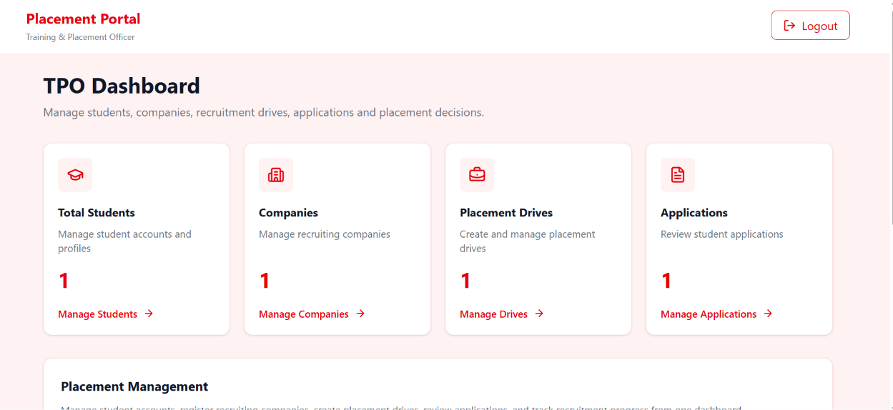
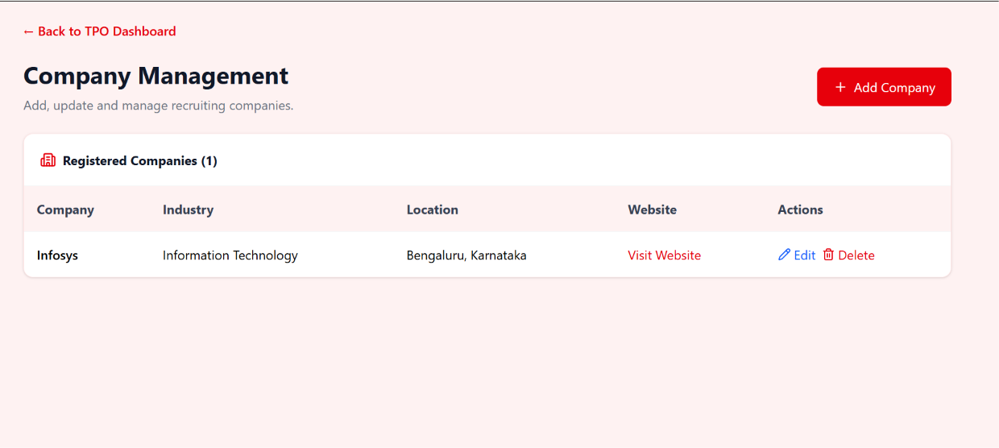
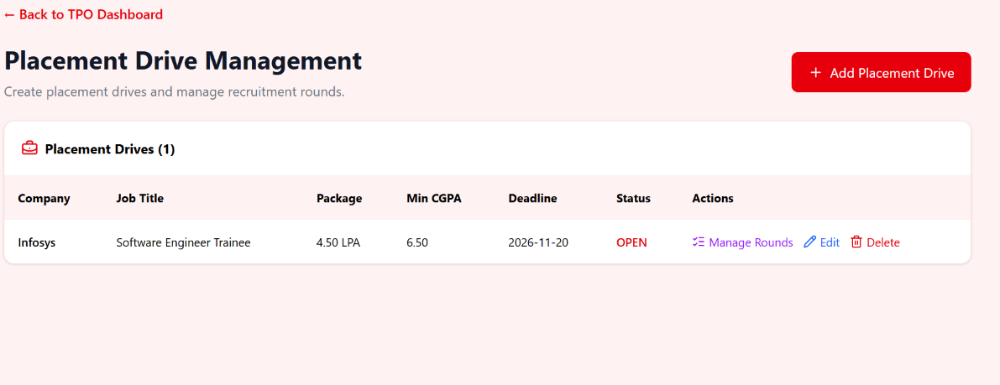
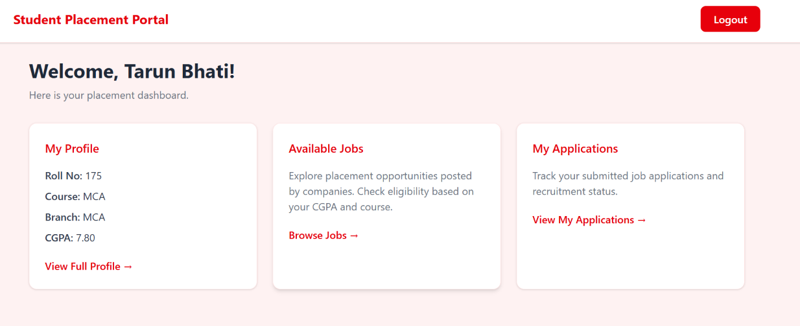
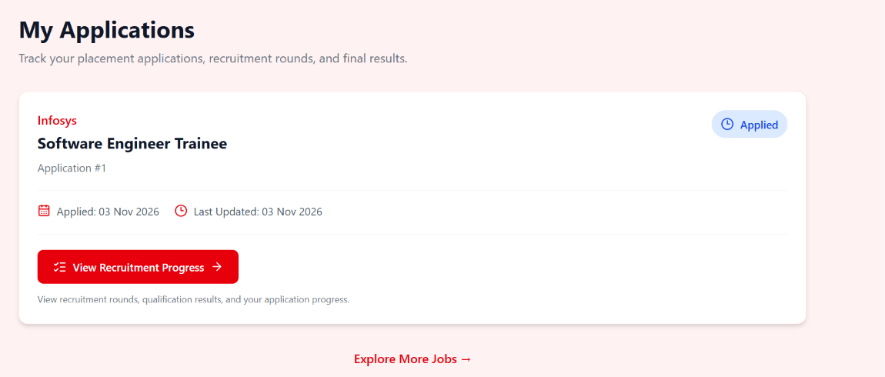

# 🎓 Student Placement Management System

A full-stack web application designed to streamline college placement activities by connecting students and Training & Placement Officers (TPOs).

Built using **Django REST Framework, React, MySQL, and Tailwind CSS** with role-based authentication, automated eligibility checking, and placement application tracking.

## 🌐 Live Demo

- 🚀 **Live Application:** https://student-placement-management-system-seven.vercel.app/
- ⚙️ **Backend API:** https://student-placement-management-system-wfjq.onrender.com/
- 💻 **GitHub Repository:** https://github.com/Siddharttiwari/Student-Placement-Management-System

> **Note:** The backend is hosted on Render's free tier. The first request after inactivity may take longer due to a cold start.

---

## 🚀 Features

### 👨‍🎓 Student Module

- Student registration and login
- Profile management
- PDF resume upload
- Browse available placement drives
- Automatic eligibility checking based on CGPA and course
- Apply for placement opportunities
- Track application status

### 👨‍💼 TPO Module

- Role-based TPO authentication
- Dashboard with placement statistics
- Company management
- Placement drive management
- Review student applications
- Shortlist, reject, and select candidates
- Search and filter applications

---

## 🛠️ Tech Stack

| Layer | Technologies |
|-------|--------------|
| Frontend | React, Vite, Tailwind CSS |
| Backend | Python, Django, Django REST Framework |
| Database | MySQL |
| Authentication | Django Session Authentication, CSRF |
| API Communication | Axios |
| Containerization | Docker |
| Frontend Deployment | Vercel |
| Backend Deployment | Render |
| Cloud Database | Aiven MySQL |
| Version Control | Git, GitHub |

---

## 🏗️ System Architecture

```text
                  ┌──────────────────────┐
                  │     User Browser     │
                  │   Student / TPO      │
                  └──────────┬───────────┘
                             │
                             ▼
                  ┌──────────────────────┐
                  │    React Frontend    │
                  │   Vite + Tailwind    │
                  │       Vercel         │
                  └──────────┬───────────┘
                             │
                        HTTPS / API
                             │
                             ▼
                  ┌──────────────────────┐
                  │    Django Backend    │
                  │ Django REST Framework│
                  │        Render        │
                  └──────────┬───────────┘
                             │
                         Django ORM
                             │
                             ▼
                  ┌──────────────────────┐
                  │    MySQL Database    │
                  │        Aiven         │
                  └──────────────────────┘
```

### Architecture Explanation

1. **React** provides the user interface for students and TPOs.
2. **Axios** communicates with Django REST APIs.
3. **Django REST Framework** handles authentication, validation, and business logic.
4. **Django ORM** manages database operations.
5. **MySQL** stores student profiles, companies, placement drives, and applications.
6. **Docker** containerizes the backend for consistent deployment.

---

## 📁 Project Structure

```text
Student_Placement_Portal/
│
├── backend/
│   ├── accounts/
│   ├── students/
│   ├── companies/
│   ├── placements/
│   ├── config/
│   ├── Dockerfile
│   ├── requirements.txt
│   └── manage.py
│
├── frontend/
│   ├── src/
│   │   ├── api/
│   │   ├── pages/
│   │   └── App.jsx
│   ├── package.json
│   └── vercel.json
│
├── .gitignore
└── README.md
```

---

## 🔄 Placement Workflow

```text
Student Registration
        │
        ▼
Complete Student Profile
        │
        ▼
Browse Placement Drives
        │
        ▼
Eligibility Verification
        │
        ▼
Submit Application
        │
        ▼
TPO Reviews Application
        │
        ▼
Shortlisted / Selected / Rejected
        │
        ▼
Student Tracks Status
```

### Workflow Steps

1. Student registers and completes their profile.
2. TPO registers recruiting companies.
3. TPO creates placement drives with eligibility criteria.
4. The system checks student eligibility.
5. Eligible students apply for placement opportunities.
6. TPO reviews submitted applications.
7. TPO shortlists, selects, or rejects candidates.
8. Students track their application status.

---

## 🧪 Production Testing

The application has been tested end-to-end in the production environment.

| Test Case | Status |
|-----------|--------|
| TPO Dashboard | ✅ Passed |
| Create Company | ✅ Passed |
| Create Placement Drive | ✅ Passed |
| Student Registration | ✅ Passed |
| Student Login | ✅ Passed |
| Apply for Placement Drive | ✅ Passed |
| TPO Application Review | ✅ Passed |

**Result: 7/7 production workflow tests passed.**

---

## ⚙️ Local Setup

### 1. Clone Repository

```bash
git clone https://github.com/Siddharttiwari/Student-Placement-Management-System.git
cd Student-Placement-Management-System
```

### 2. Backend Setup

```bash
cd backend
python -m venv venv
```

Activate the virtual environment on Windows:

```powershell
venv\Scripts\activate
```

Install dependencies:

```bash
pip install -r requirements.txt
```

Configure MySQL and required environment variables in a local `.env` file.

Apply database migrations:

```bash
python manage.py migrate
```

Start Django:

```bash
python manage.py runserver
```

### 3. Frontend Setup

Open another terminal from the project root:

```bash
cd frontend
npm install
npm run dev -- --host 127.0.0.1
```

Open:

http://127.0.0.1:5173

---

## 🐳 Docker

Docker is used to containerize the application backend.

### Benefits

- Consistent development and deployment environments
- Simplified dependency management
- Portable backend deployment
- Easier integration with cloud hosting platforms

The production backend runs in a Docker container on Render and connects to the Aiven MySQL database.

---

## ☁️ Cloud Deployment

| Component | Platform |
|-----------|----------|
| React Frontend | Vercel |
| Django REST API | Render |
| MySQL Database | Aiven |
| Source Code | GitHub |

### Deployment Flow

```text
GitHub Repository
        │
        ├───────────────┐
        │               │
        ▼               ▼
      Vercel          Render
    (Frontend)       (Backend)
                        │
                        ▼
                    Aiven MySQL
```

---

## 🔐 Security

- Role-based access control
- Django session authentication
- CSRF protection
- Environment variables for sensitive configuration
- HTTPS communication in production
- SSL configuration for the hosted MySQL database

---
## 📸 Application Screenshots

### 🖥️ TPO Dashboard



### 🏢 Company Management



### 💼 Placement Drive Management



### 🎓 Student Dashboard



### 📋 Application Tracking



---
---

## 🔮 Future Enhancements

- AI-powered resume analysis
- Intelligent job recommendations
- Automated email notifications
- Advanced placement analytics
- Improved search and filtering

---

## 👨‍💻 Author

**Siddharth Tiwari**

MCA Student | Python | Django | React | AI/ML

---

## 📄 License

No license has been specified yet.